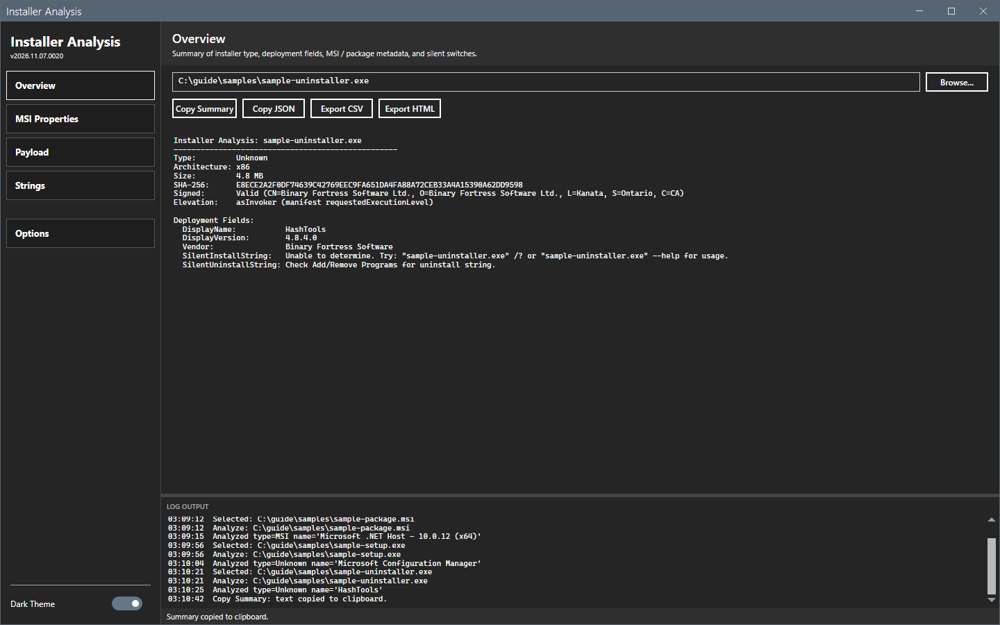
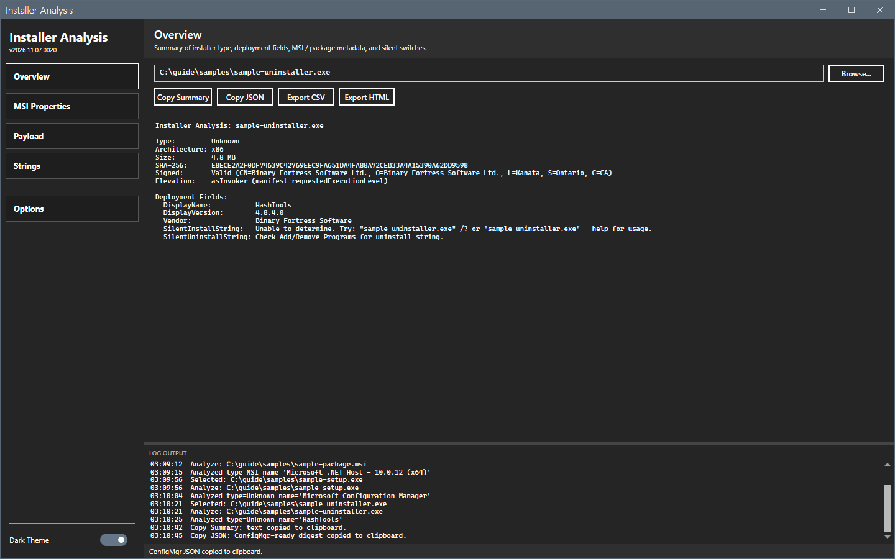
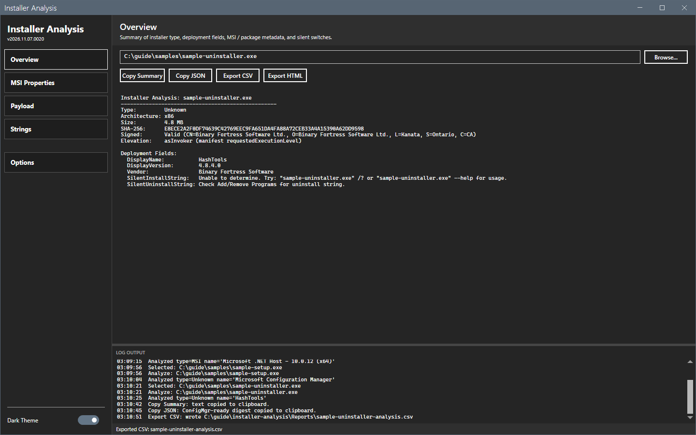

# Export and copy

The buttons under the path box copy or save the analysis.

## What it does

| Button | Result |
|---|---|
| **Copy Summary** | Puts the Overview text on the clipboard, ready to paste into a ticket or a change record. |
| **Copy JSON** | Puts a JSON digest on the clipboard, with detection hints for the installer type. |
| **Export CSV** | Saves the analysis table as a CSV file. |
| **Export HTML** | Saves the analysis as an HTML page. |

## When to use it

Use it to hand the data to a ticket, a script or a colleague.

## Requirements

An analyzed file. Without one, each button writes a message such as `Copy Summary: no analysis result yet.` in the log.

## Steps

### Copy

1. Select **Copy Summary** or **Copy JSON**. The status bar confirms the copy.

### Save a file

1. Select **Export CSV** or **Export HTML**. The Save As dialog opens in the reports folder. The reports folder is set in [Options dialog](options.md). The default is `Reports` beside the script.
2. Keep the name or type a new name and select **Save**.

## Options and settings of this page

The reports folder is on the **Reports** page of [Options dialog](options.md).

## Limits

- The `.intunewin` key material (EncryptionKey, MacKey, IV and Mac) is redacted by default in the output.
- **Extract Payload** is a separate action. See [Payload and inner installers](payload.md).

## Troubleshooting

| Message or symptom | Cause | Fix |
|---|---|---|
| `Export CSV failed: <reason>` and `Export HTML failed: <reason>` | The tool cannot write the file. | Read the reason. Choose a writable folder. |
| `Copy JSON: no analysis result yet.` | No file is analyzed. | Open a file first. |

## Links

- [Overview](overview.md)
- [Options dialog](options.md)
