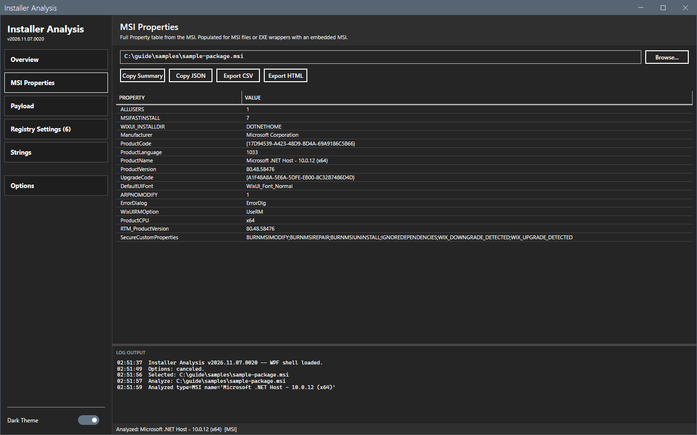

# MSI Properties

The MSI Properties view shows the property table of an MSI.

## What it does

The view lists every property of the MSI with its value, for example `ProductCode`, `UpgradeCode`, `ProductVersion` and `Manufacturer`. The sidebar button shows for an MSI, an MSP, or an EXE wrapper with an MSI inside.

## When to use it

Use it to find a property that you need for a transform, a detection method or a command line.

## Requirements

An analyzed MSI or an EXE with an MSI inside.

## Steps

1. Open an MSI. See [Getting started](../getting-started.md).
2. Select **MSI Properties** in the sidebar.

3. Use **Copy Summary** or the exports to take the data.

## Options and settings of this page

| Control | Effect |
|---|---|
| **Copy Summary**, **Copy JSON**, **Export CSV**, **Export HTML** | See [Export and copy](export.md). |

## Limits

- The tool reads the properties with the vendored `MSI` module, and with the `WindowsInstaller` COM object when the module cannot load.
- The tool reads the file. It does not apply transforms.

## Troubleshooting

| Message or symptom | Cause | Fix |
|---|---|---|
| The button is missing. | The file is not an MSI and holds no MSI. | Open an MSI. |

## Links

- [Overview](overview.md)
- [Registry Settings and Strings](registry-and-strings.md)
