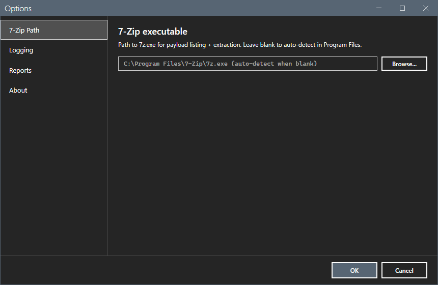
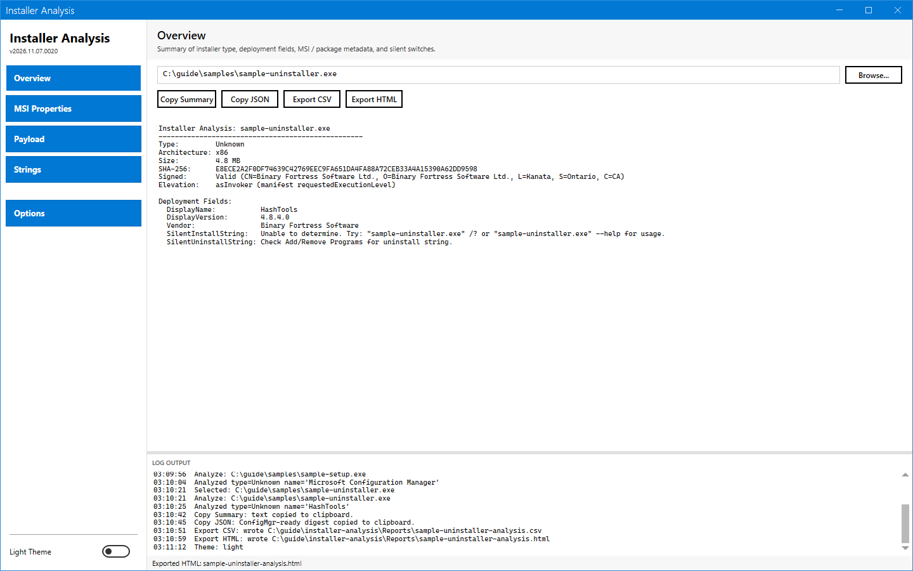
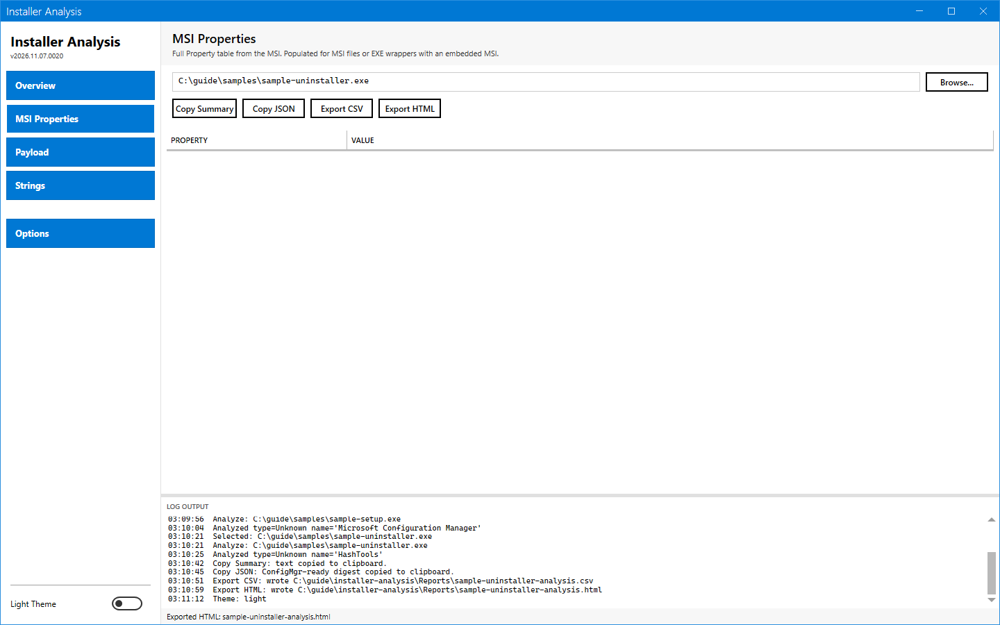
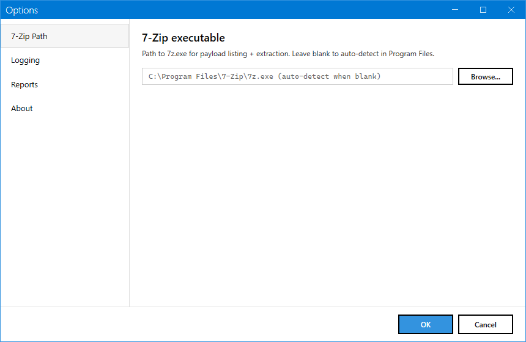
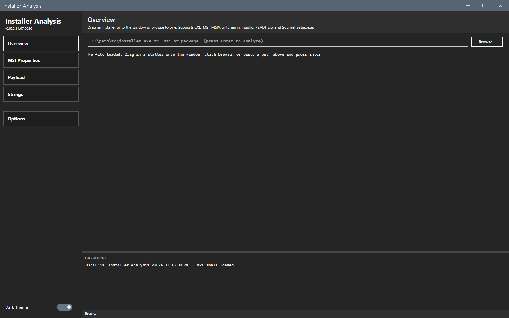

# Options dialog

The Options dialog sets the 7-Zip path, shows the logging and sets the reports folder.

## What it does

The dialog has four pages: **7-Zip Path**, **Logging**, **Reports** and **About**. **OK** saves. **Cancel** closes the dialog and keeps the old values. The log shows `Options: canceled.` after **Cancel**.

## When to use it

Use it when 7-Zip is not in Program Files, or to choose the folder for exports.

## Requirements

None.

## Steps

### 7-Zip Path

Type the path of `7z.exe` or select **Browse...**. Leave the box empty to find 7-Zip in Program Files by itself.

### Logging

The page names the folder of the session logs, the `Logs` folder beside the script, and has the button **Open Logs Folder**.

### Reports

Select the default folder for CSV and HTML exports.

### About

The page shows the version and a short description.

### Theme

The **Dark Theme** switch at the bottom of the sidebar changes the theme. The tool keeps the choice.

### Start again

The tool saves the last folder that you browsed and the window place. After a restart the window opens empty.

## Options and settings of this page

See the sections above. [Settings](../reference/settings.md) lists the file keys.

## Limits

- The 7-Zip path is only for payload listing and extraction.

## Troubleshooting

| Message or symptom | Cause | Fix |
|---|---|---|
| `7-Zip not found. Configure the path in Options > 7-Zip.` | The path is wrong or 7-Zip is not installed. | Set the path of `7z.exe`. |

## Links

- [Settings](../reference/settings.md)
- [Payload and inner installers](payload.md)
