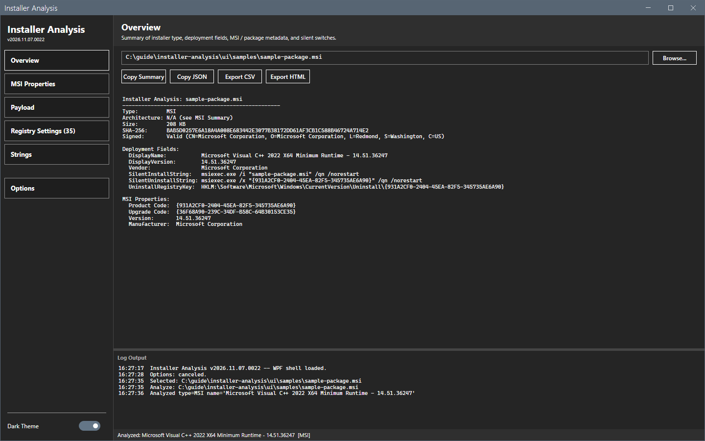
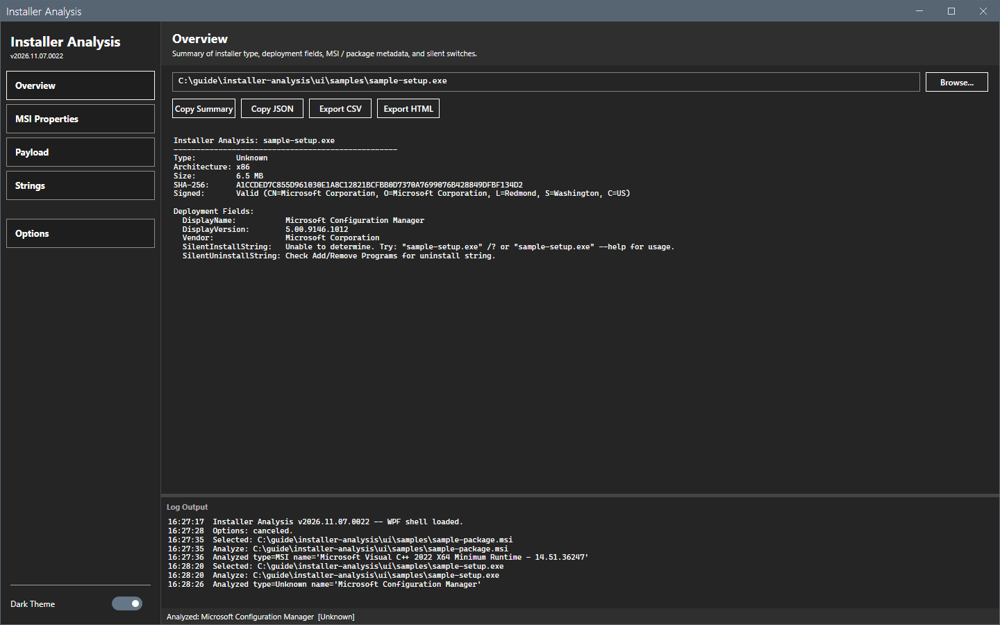
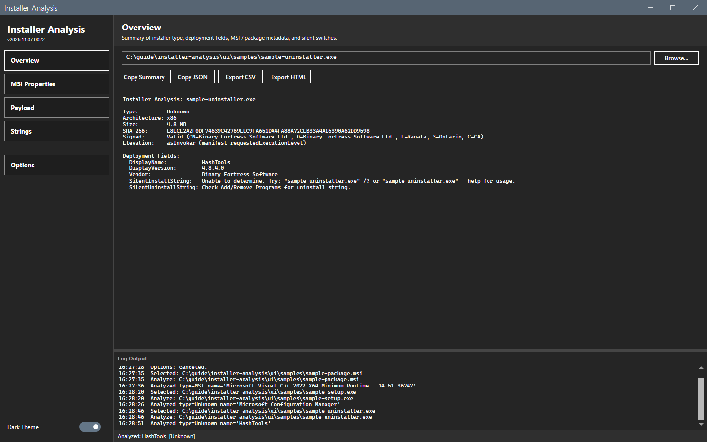

# Overview

The Overview shows the result of the analysis as text that you can copy.

## What it does

The text has these blocks. A block shows only when the file has data for it.

- **Source facts**: the type, the architecture, the size, the SHA-256 hash and the Authenticode signature with the signer.
- **Deployment fields**: `DisplayName`, `DisplayVersion`, `Vendor`, the silent install command, the silent uninstall command and the predicted uninstall registry key, which is the key in Add/Remove Programs.
- **MSI properties**: the product code, the upgrade code, the version and the manufacturer, for an MSI.
- **Package metadata**: a block for the detected type, for example the nuspec of a `.nupkg` or the manifest of an MSIX.
- **Compiled script data**: for NSIS and Inno Setup installers, the data that the compiled script holds, for example the install folder, the uninstall command and the privilege level.

## When to use it

Use it to author a detection method and a deployment type without installing the product.

## Requirements

An analyzed file. See [Getting started](../getting-started.md).

## Steps

### Read an MSI

1. Open an MSI. The Overview shows the type `MSI`, the signer, the product name and version, the silent install command `msiexec.exe /i "<file>" /qn /norestart` and the silent uninstall command with the product code.

2. Use the product code for a Windows Installer detection method. The uninstall registry key follows the product code.

### Read an EXE

1. Open an EXE. The type is one of the [Installer types](../reference/installer-types.md), or `Unknown`.
2. For an unknown type the tool shows the file version data and the text `Unable to determine`. The text names switches, for example `/?` or `--help`. Try them only with a file that you trust and in an isolated environment. The file can ignore them and start an installation or an uninstallation.

An uninstaller file is not an installer. The tool does not know it as an installer type.

### Copy a path or open its folder

Right-click the path box, or press Shift+F10 with the focus in it. The menu has **Cut**, **Copy**, **Paste**, **Select All**, **Copy Path**, **Open Enclosing Folder** and **Re-Analyze**.

This guide did not capture the menu: a menu is a separate window that the capture does not include.

## Options and settings of this page

| Control | Effect |
|---|---|
| **Browse...** | Opens a file dialog. |
| The path box | Shows the file. Edit it and press Enter to analyze another file. |
| **Copy Summary**, **Copy JSON**, **Export CSV**, **Export HTML** | See [Export and copy](export.md). |

## Limits

- The silent switches of an unknown EXE are not known. The text says so.
- The tool does not run the installer. A value that the installer computes at run time shows as a prediction.

## Troubleshooting

| Message or symptom | Cause | Fix |
|---|---|---|
| The Overview is empty. | No file is open. | Select **Browse...**. |
| `Unable to determine` for the silent install command. | The type has no known silent switch. | Read the documentation of the vendor. Try `/?` and `--help` only with a trusted file in an isolated environment. |

## Links

- [MSI Properties](msi-properties.md)
- [Installer types](../reference/installer-types.md)
