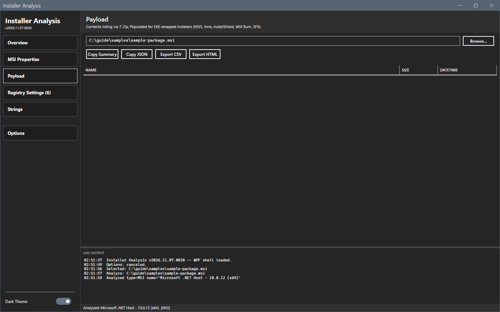

# Payload and inner installers

The payload views list the files inside an EXE wrapper.

## What it does

For an EXE-wrapped installer (NSIS, Inno Setup, InstallShield, WiX Burn, 7-Zip SFX), the **Payload** view lists the contents with 7-Zip: the name, the size and the date. When the payload has installers inside, the **Embedded** view classifies them: inner MSIs, MSPs, EXEs, `.nupkg` files and cabinet files. **Files** shows the payload as a folder tree. Right-click menus extract, copy and hash entries.

## When to use it

Use it to find the MSI inside a setup EXE, or to read an inner installer on its own.

## Requirements

- 7-Zip. The tool finds `7z.exe` in Program Files or at the path that you set in [Options dialog](options.md).

## Steps

### List the payload

1. Open an EXE wrapper. Select **Payload** in the sidebar.
2. Read the list. On an MSI, or without 7-Zip, the list is empty.

### Analyze an inner installer

1. Select **Embedded** in the sidebar. The button shows only when the payload has installers.
2. Select a row and select **Analyze Selected**. The tool extracts the entry to a sandboxed temporary folder and analyzes it. A breadcrumb bar with a back button shows the path. The drill depth is at most 5.
3. Select **Open in new window** to compare the outer and the inner installer side by side.
4. Select **Extract All** to extract the inner installers to a folder.

### Browse the files

Select **Files** in the sidebar. The tree shows the folders and the grid shows the files. The buttons **Up**, **Extract Selected** and **Extract This Folder** extract entries.

### Use the right-click menus

A payload row has **Extract to temp folder**, **Copy name**, **Copy full path** and **Hash (SHA-256)**. An inner installer row also has **Analyze Selected** and **Open in new window**.

This guide ran on a lab computer without 7-Zip. It shows the empty **Payload** view. The **Embedded** and **Files** views and the right-click menus were read from the README and the code. They were not run.

## Options and settings of this page

| Control | Effect |
|---|---|
| **Analyze Selected**, **Open in new window**, **Extract All** | Work on the inner installers. |
| **Extract Selected**, **Extract This Folder**, **Up** | Work on the files. |

## Limits

- The temporary folder is deleted when you close the window.
- The tool needs 7-Zip for the payload views. Metadata reads, for example of a Velopack setup, need no 7-Zip.
- Extraction writes files to the folder that you choose.

## Troubleshooting

| Message or symptom | Cause | Fix |
|---|---|---|
| `7-Zip not found. Configure the path in Options > 7-Zip.` | The tool cannot find `7z.exe`. | Install 7-Zip or set the path. |
| `Max drill-down depth (5) reached. Extract manually to continue deeper.` | The nesting is deeper than 5. | Extract the entry and open it. |
| `Extract Payload: canceled (target not empty).` | The target folder has files. | Select an empty folder. |

## Links

- [Options dialog](options.md)
- [Overview](overview.md)
