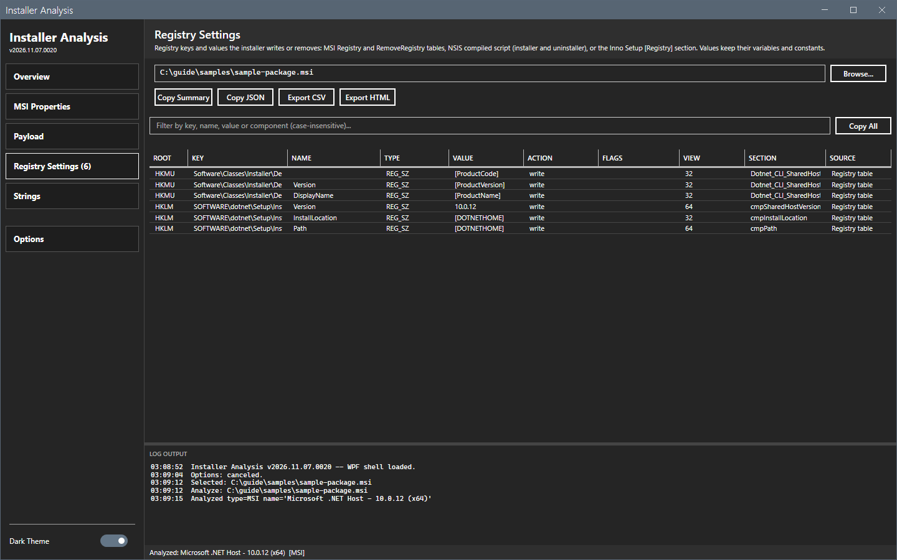
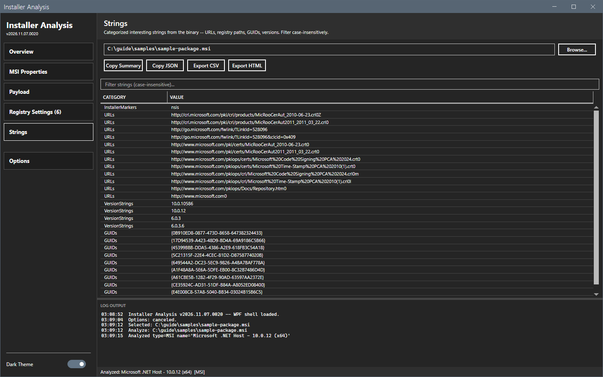

# Registry Settings and Strings

These two views show the registry keys that the installer writes and the readable strings of the file.

## What it does

**Registry Settings** lists the keys and values that the installer writes or removes. The sources are the `Registry` and `RemoveRegistry` tables of an MSI, the compiled script of an NSIS installer, and the `[Registry]` section of an Inno Setup installer. Values keep their variables and constants. The number in the button is the number of rows. **Strings** lists selected readable patterns of the file, for example product names and URLs. It scans the first 16 MB of the file only. It is not every string of the file.

## When to use it

Use it to author a registry detection method, and to look for a product name or a URL in a file. A name or a URL can be missing from the Strings view although the file holds it.

## Requirements

An analyzed file that has registry data. The Strings view needs no extra data.

## Steps

### Read the registry settings

1. Select **Registry Settings** in the sidebar.
2. Type text in the filter box. It matches the key, the name, the value and the component, without regard to case.
3. Select **Copy All** to copy every stored registry entry to the clipboard, also the entries that the filter hides. For the shown and selected rows only, use the right-click menu item that copies the selected rows. The menu also copies the key or the value.

The columns are **Root**, **Key**, **Name**, **Type**, **Value**, **Action**, **Flags**, **View**, **Section** and **Source**. **View** is `32` or `64`. **Source** names the table or the script.

### Read the strings

Select **Strings** in the sidebar. Use the filter box to find text.

## Options and settings of this page

| Control | Effect |
|---|---|
| Filter box | Filters the rows. |
| **Copy All** | Copies the rows of the registry view. |

## Limits

- A long key or value is cut in the grid. Select **Copy All** to read it in full.
- **Copy All** copies the entries that the filter hides too.
- The tool reads registry data from the file. It does not run the installer.

## Troubleshooting

| Message or symptom | Cause | Fix |
|---|---|---|
| The button is missing. | The file has no registry data. | None. |
| `Copy All: no registry settings listed.` | The tool stored no registry entry for the file. | Open a file that has registry data. |

## Links

- [Overview](overview.md)
- [Export and copy](export.md)
