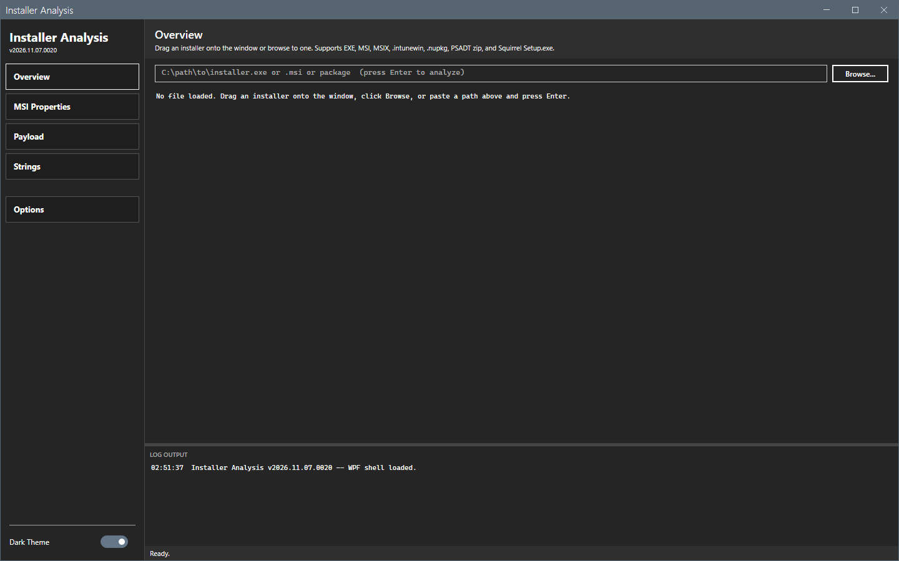
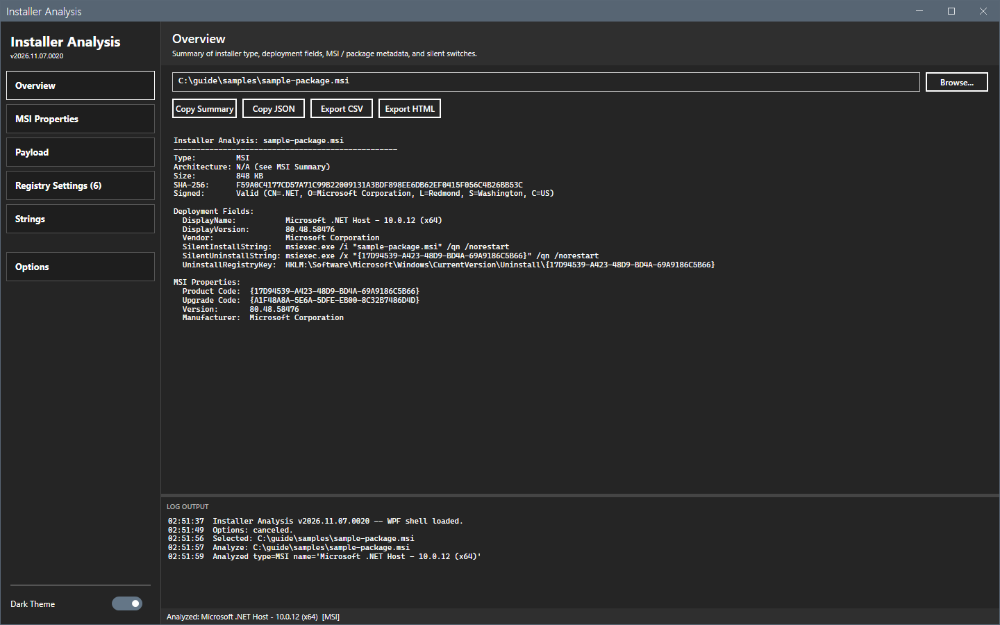

# Getting started

This page shows how to start Installer Analysis, open an installer and read the Overview.

## What it does

The tool reads the metadata of an installer file: its type, architecture, size, SHA-256 hash and signature, and the deployment fields that you need for Configuration Manager, Intune or Chocolatey. It works on the file only. It does not run the installer.

## When to use it

Use it before you package an application, to find the silent install command, the uninstall command and the product code without installing the product.

## Requirements

- Windows 10 or Windows 11, Windows PowerShell 5.1 and .NET Framework 4.7.2 or later.
- Optional: 7-Zip, for the payload list and the inner installers. The rest of the analysis runs without it.
- No administrator rights, no network and no Configuration Manager console. The tool does not connect to a site.

## Steps

### Start the tool

1. Extract the release zip to a folder that you can write to. The tool saves its settings and logs in that folder.
2. Right-click `start-installeranalysis.ps1` and select **Run with PowerShell**. Or run this command:

```powershell
powershell -ExecutionPolicy Bypass -File start-installeranalysis.ps1
```

To open a file at the start, add `-StartupFile <path>`.

The window opens on the **Overview**. It is empty until you open a file.



### Open an installer

1. Select **Browse...**, select the file and select **Open**. Or drag the file onto the window.
2. Wait for the status bar to show `Analyzed: <name> [<type>]`.



### Read the result

Read the Overview. See [Overview](core/overview.md). Use the sidebar to open the other views. The sidebar shows only the views that the file has data for.

## Options and settings of this page

None. The settings are on [Options dialog](core/options.md).

## Limits

- The tool reads one file at a time. A second file replaces the first.
- A file that the tool does not know shows the type `Unknown`. The Overview then shows the file version data only.

## Troubleshooting

| Message or symptom | Cause | Fix |
|---|---|---|
| The log shows `7-Zip not found. Configure the path in Options > 7-Zip.` | The payload views need 7-Zip. | Install 7-Zip or set its path in Options. |
| The type is `Unknown`. | The file is not one of the detected types. | See [Installer types](reference/installer-types.md). |

## Links

- [Overview](core/overview.md)
- [Options dialog](core/options.md)
- [Troubleshooting](troubleshooting.md)
